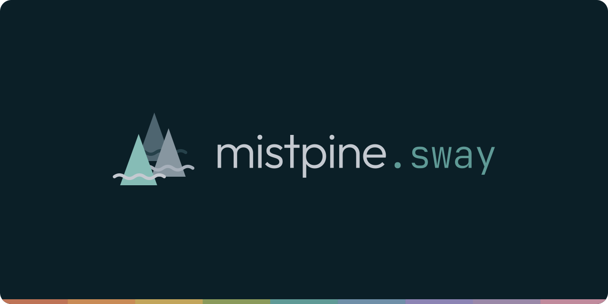
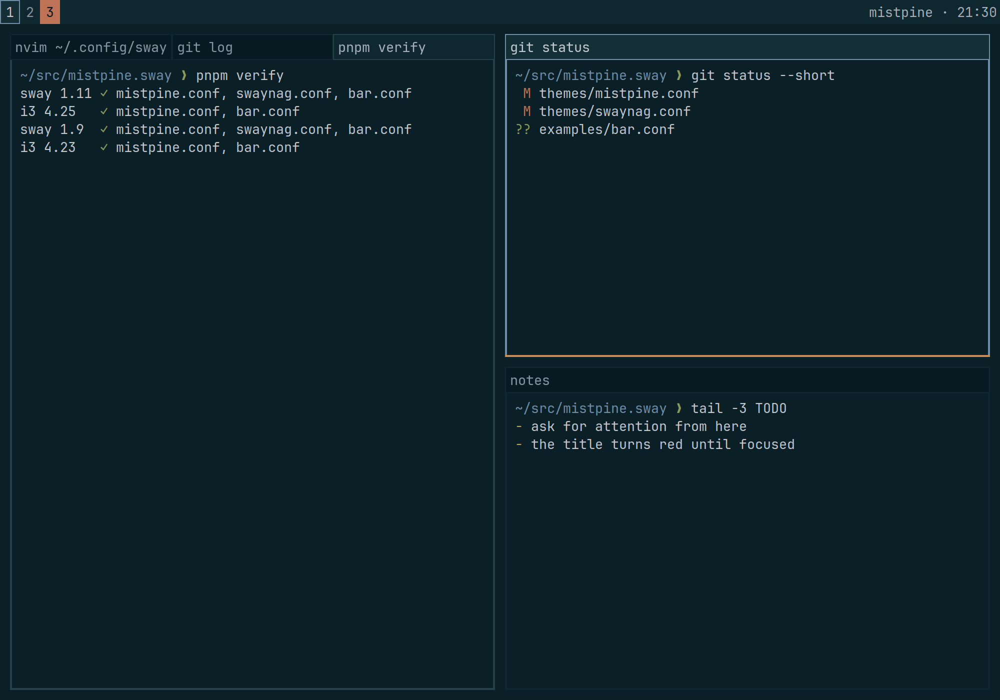
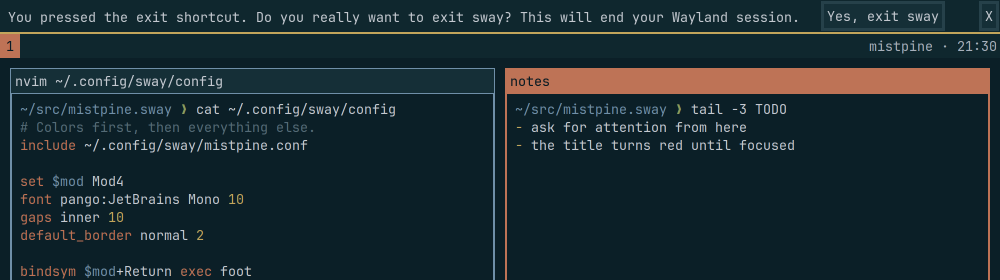
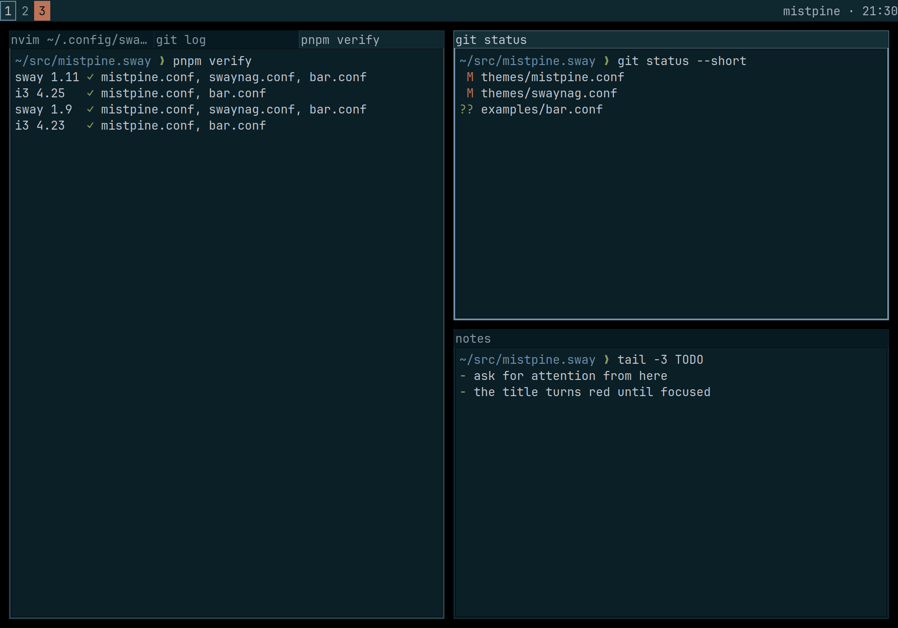

<p align="center">
  
</p>

<p align="center">
  
</p>

**mistpine** for [sway](https://swaywm.org) and [i3](https://i3wm.org): cool,
misty grays over a deep blue-green night, with muted, earthy accents. It is
the sway and i3 port of [mistpine](https://github.com/mistpine/mistpine) and
follows the
[mistpine spec](https://github.com/mistpine/mistpine/blob/main/docs/spec.md):
every color is the spec's, generated from its palette file and checked
against sway and i3 themselves.

- One file for both window managers: the window colors, plus the palette as
  `$mistpine-*` variables.
- The focused window raised in a blue frame, with the split indicator in
  orange; everything else recedes. Urgent windows and workspaces in red.
- swaybar and i3bar colors to paste into your `bar` block, and a swaynag
  theme.
- sway 1.9 and later, i3 4.23 and later. Gaps, borders, fonts and keys stay
  in your config.

The screenshots are the real apps, sway 1.11 and i3 4.25, and the render
fails if a single color comes out different from the spec.

## Install

```sh
mkdir -p ~/.config/sway
curl -fsSL -o ~/.config/sway/mistpine.conf \
  https://raw.githubusercontent.com/mistpine/mistpine.sway/main/themes/mistpine.conf
```

Then include it near the top of `~/.config/sway/config`, and remove any
`client.*` lines of your own (the last one of each class wins):

```
include ~/.config/sway/mistpine.conf
```

Reload with `$mod+Shift+c` or `swaymsg reload`.

**i3** reads the same file. Save it as `~/.config/i3/mistpine.conf`, include
it from `~/.config/i3/config` the same way, and reload with `i3-msg reload`.
If sway and i3 share a config file, include it once there.

### Window colors

| Class | Title bar | Title text | Frame | Indicator |
| --- | --- | --- | --- | --- |
| `focused` | `bg3` `#152f37`, `blue` border | `fg3` `#c4c9d0` | `blue` `#6f8fa8` | `orange` `#c98b56` |
| `focused_inactive` | `bg2` `#0f272e`, `bg4` border | `fg2` `#a7b0bb` | `bg4` `#26414a` | `bg4` |
| `focused_tab_title` | `bg2`, `bg4` border | `fg2` | | |
| `unfocused` | `bg0` `#071921`, `bg2` border | `fg1` `#8796a0` | `bg2` | `bg2` |
| `urgent` | `red` `#be7356` | `bg0` | `red` | `red` |
| `placeholder` | `bg0` | `fg2` | `bg0` | `bg0` |

`client.background` is `bg1` `#0b1f27`, the spec's canvas (i3 only; sway
ignores it).

### The palette as variables

`mistpine.conf` sets every palette color as a variable, from
`$mistpine-bg0` to `$mistpine-bright-cyan`. In sway they work anywhere after
the `include`:

```
client.focused $mistpine-green $mistpine-bg3 $mistpine-fg3 $mistpine-orange $mistpine-green
```

i3 keeps variables inside the file that sets them, so in i3 use the hex
values instead (they are in the file, one per line).

## Bar

For swaybar or i3bar, put this `colors` block inside your `bar { }` block
([`examples/bar.conf`](examples/bar.conf); it is in hex so it works in both):

```
colors {
    # class            border  background text
    background         #0f272e
    statusline         #a7b0bb
    separator          #26414a
    focused_workspace  #6f8fa8 #152f37    #c4c9d0
    active_workspace   #26414a #0f272e    #a7b0bb
    inactive_workspace #0f272e #0f272e    #8796a0
    urgent_workspace   #be7356 #be7356    #071921
    binding_mode       #c2a55b #c2a55b    #071921
}
```

The bar is a status line (`bg2`, `fg2`); the focused workspace is raised like
the focused title; a binding mode such as resize is yellow, a warning that
the keys do something else now.

Using another bar? See [mistpine.waybar](https://github.com/mistpine/mistpine.waybar)
and [mistpine.polybar](https://github.com/mistpine/mistpine.polybar).

## swaynag

```sh
mkdir -p ~/.config/swaynag
curl -fsSL -o ~/.config/swaynag/config \
  https://raw.githubusercontent.com/mistpine/mistpine.sway/main/themes/swaynag.conf
```

It themes the `error` and `warning` types (sway's own messages and the exit
prompt): the bar is a status line with a red or yellow edge. Already have a
swaynag config? Copy the two sections into it. i3-nagbar has no colors to
set.



## Screenshots

The same desktop in i3, on X11:



## Development

Requires Node 24+, pnpm (`corepack enable`) and Docker.

The spec loader, color math, banner and pixel checks come from
[@mistpine/port-kit](https://github.com/mistpine/port-kit), shared by every
mistpine port.

```sh
pnpm install
pnpm generate  # themes/ and examples/ from the mistpine spec
pnpm check     # fail if they are out of date
pnpm verify    # sway 1.9 and 1.11, i3 4.23 and 4.25 load them, and report the spec's colors
pnpm render    # README screenshots from sway and i3, with pixel checks
pnpm banner    # assets/banner.svg and the social preview (Chromium)
pnpm lint && pnpm typecheck
```

Never edit `themes/` or `examples/` by hand. `scripts/generate.ts` maps each
window, bar and swaynag color to a spec role, reads the colors from
[`palette/mistpine.json`](https://github.com/mistpine/mistpine/blob/main/palette/mistpine.json)
(from `$MISTPINE_DIR`, `../mistpine` or GitHub), and requires 4.5:1 for every
text color on its background.

`pnpm verify` and `pnpm render` run in Docker: Ubuntu 24.04 for sway 1.9 and
i3 4.23, Ubuntu 26.04 for sway 1.11 and i3 4.25 (`scripts/render/Dockerfile`).
verify reads every color back from the files, runs `sway -C` and `i3 -C`
(both exit 0 even when a line fails, so any error in their output fails it),
compares the bar colors sway and i3 report over IPC with the spec, and starts
swaynag with each type. The window colors have no IPC, so render checks them
on screen: headless sway and Xvfb with foot and xterm windows, exact-pixel
counts for every role.

## Credits

- Designed in [themes.utimura.io](https://themes.utimura.io).
- [Outfit](https://github.com/Outfitio/Outfit-Fonts) and
  [JetBrains Mono](https://github.com/JetBrains/JetBrainsMono) in the banner.
  The screenshots use JetBrains Mono.

## License

[MIT](LICENSE).
